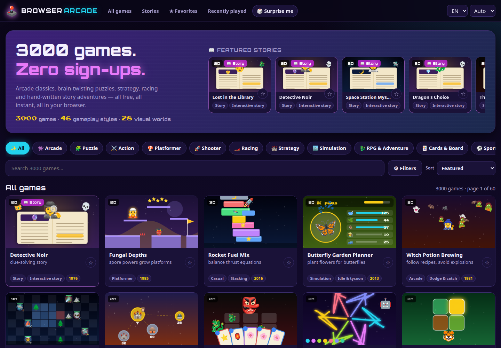

# Browser Arcade

A free browser game platform with **3000 games** you can play instantly — arcade classics, puzzles, strategy, racing, sports, music toys and hand-written interactive stories. No registration, no login, no downloads, no tracking: everything runs on a static GitHub Pages site and your scores stay in your browser.

**▶ Play now: https://hermes98761234.github.io/browser-arcade/**

[](https://github.com/hermes98761234/browser-arcade/actions/workflows/deploy.yml)



## Features

- **3000-game catalog** with 50 games per page, live search and filters: genre, visual style, gameplay type, era (year the genre was born), 2D/3D, players, controls, difficulty and the 120 themed collections.
- **Canvas preview image** for every game, drawn from the game's own engine and theme.
- **Story games** with hand-written branching plots and multiple endings.
- Favorites, recently played and personal best scores (stored locally).
- Keyboard, mouse and touch controls with an on-screen gamepad on phones; local two-player modes.
- English and Ukrainian interface, dark and light themes, fullscreen play.

## Game engines

46 engines, each with variants picked from the game's own description:

| Group | Engines |
|---|---|
| Arcade & action | snake, brick breaker, shoot 'em up / bullet hell, twin-stick & .io arenas, dodge & catch, one-button flyer & lunar lander, reflex & timing, endless runner, platformer (procedural levels), fighting, paddle sports |
| 3D | three.js flight, raycaster mazes & dungeons, pseudo-3D racing |
| Puzzle | match-3, sliding & pipe puzzles, memory & spot-the-difference, minesweeper / nonogram / sudoku / akari / binairo, 2048 & merge, Lights Out / Flood-It / lasers, mazes & flow lines, sokoban, falling blocks & polyomino packing, stacking, ball sort, chain reaction, escape rooms |
| Strategy & sim | tower defense, Galcon-style conquest, turn-based tactics & auto-battler, idle tycoon / farming / trading, Reigns-style decision cards, Oregon-Trail-style journeys, roguelike dungeons |
| Cards & board | solitaire, blackjack, video poker, deck-builder, lane battler; chess (alpha-beta AI), checkers, reversi, connect four, go, mancala, gomoku… |
| Words & learning | wordle, crossword, hangman, ciphers, spelling hive, word search, typing shooter, quizzes (math, geography, science, languages, trivia), Lightbot-style programming |
| Creative & music | drawing with symmetry, falling sand, generative art, pixel art, step sequencer, piano, theremin, procedurally composed rhythm game |
| Stories | 10 hand-written branching stories (40–60 scenes, 5–7 endings each) |

Every engine works with keyboard, mouse and touch, and adapts to portrait phone screens.

## How it works

The game list lives in [`data/games.md`](data/games.md): 3000 one-line game designs in 120 collections. `scripts/build-catalog.mjs` parses it into `src/data/raw.json`, and `src/lib/catalog.ts` classifies every entry — from its name, description and build notes — into one of the gameplay **engines** in `src/engines/games/`, a visual **theme** (palette + sprite set), a genre and a set of variant flags (`gravity`, `boss`, `dark`, `versus`, …). Each game runs its engine with its own theme, flags and random seed, so games that share mechanics still look and play differently. Engines are lazy-loaded, so the catalog stays fast.

## Quick start

```bash
npm install
npm run dev      # http://localhost:5173
npm test         # catalog, classifier and i18n tests
npm run build    # static site in dist/
```

## License

MIT — see [LICENSE](LICENSE).
